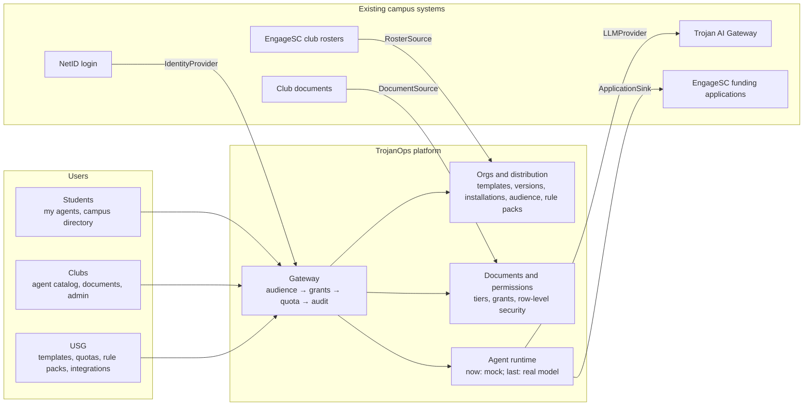

# TrojanOps

**Governed AI agents for USC student government and student clubs.**

TrojanOps connects the systems a campus already has — NetID login, club rosters, club documents, a
campus model gateway — into one platform where USG distributes agents, quotas and document
permissions to clubs, clubs expose agents to their members or to every student, and **every agent
run goes through the platform gateway**. What a single run is allowed to read is decided by
PostgreSQL row-level security, not by prompt text.

Built for the **AI@USC Hackathon**, November 14–15 2026. The platform runs end to end on a mock
agent runtime; real agents (model, retrieval, tools) are the last layer and are not wired yet (see
[Status](#status)). This is a student hackathon project and is not affiliated with USC or USG.

---

## What it does

**Students** sign in and get agents without asking anyone for access:

- `/me/agents` — per club, the agents that club exposes to them, each with the reason it is open
  to them ("All members", "Treasurer", "All students").
- `/directory` — every club's public agents, open to any signed-in student, no membership needed.

**Clubs** run their own agents and decide who may use them:

- `/org/[orgId]` — club home: my agents here, recent documents, my usage this month.
- `/org/[orgId]/catalog` — agents installed in, or available to, this club.
- `/org/[orgId]/documents` — the document library, each document tagged with a tier.
- `/org/[orgId]/preview` — "who can read what through this agent", before publishing it.
- `/org/[orgId]/admin` — members, positions, succession, per-member quotas, installations.
- `/org/[orgId]/audit` — every run and tool call in this club.

**USG** governs the whole campus from one console:

- `/usg/templates` — agent templates and versions; distribute to a cohort or to all clubs.
- `/usg/clubs` — per-club quotas and club policy (which model classes, may it publish publicly).
- `/usg/rule-packs` — versioned policy (funding caps, deadlines) that takes effect on the next run.
- `/usg/integrations` — every connector, its current implementation and last sync.
- `/usg/audit` — campus-wide audit, metadata only.

## Architecture



| Layer | Responsibility |
|---|---|
| Campus integration | Each touchpoint is one interface: `IdentityProvider`, `RosterSource`, `DocumentSource`, `LLMProvider`, `ApplicationSink`. All five ship as mock implementations; swapping in a real system changes nothing else. `/usg/integrations` shows each interface's current implementation and last sync. |
| Gateway | The single entry point for every agent run and tool call. A server module, not Next.js `middleware`, because it sets the request's grants inside the database transaction and settles quota on actual usage. |
| Orgs and distribution | USG and clubs are both orgs. Templates are versioned; installations belong to a club. Audience (who may use it) and max tier (how deep it may read) are declared separately. Rule packs are versioned and take effect on the next run. |
| Documents and permissions | Documents belong to a club and carry a tier; a trigger writes their read grants. The database, through row-level security, decides what a given run can read. |
| Agent runtime | Behind the `AgentRuntime` interface. The mock implementation calls no model and instead reports exactly which documents the run was allowed to read; the real one plugs into a model through `LLMProvider`. |

### How agents reach people

| Direction | Published by | Used by | Seeded example |
|---|---|---|---|
| USG → clubs | USG | named positions, or all members, in every club | `funding-precheck`, `event-planning` |
| Club → own club | the club | its members, or named officers | `handoff`, meeting minutes Q&A |
| Club → all students | the club | any signed-in student, members or not | `recruiting-qa` |

Usage of a public agent is billed to the club that published it, and each student has a separate
daily cap, so opening an agent to campus cannot drain a club's month in an afternoon.

### How a run is governed

1. Resolve the agent's effective config; reject if the template is retired or the installation is
   disabled.
2. Check the user is inside the agent's audience.
3. Recompute the user's grants for the agent's org, then clamp them to the agent's max tier.
4. Reserve quota against four ceilings — platform, billed club, installation, member — plus the
   student daily cap for public agents. Any ceiling blocks the run **before** the runtime is called.
5. Inside a database transaction, set the grants; row-level security lists the readable documents.
6. Call the agent runtime.
7. Write tools only produce a pending action; a human with the right position confirms it.
8. Settle on actual usage, then write the run record and the audit entry.

### Permission model

A grant is a string that says "which people in which org":

- `*` — every signed-in student;
- `<org>:*` — every member of that club;
- `<org>:<position>` — a named position in that club (officer-tier documents always include the
  president).

A user's grants are recomputed on every request from live memberships in the active org — never
stored in a cookie or a token, never carrying positions held in another club. They are then clamped
by the agent's max tier: `public` keeps only `*`, `members` keeps up to `<org>:*`, `officers` keeps
the lot.

A document is readable only if **both** hold:

- its read grants intersect the run's clamped grants, and
- it is inside the agent's declared sources.

A public agent's max tier is always `public`, which is why a club can open an agent to all of USC
without leaking its own minutes or budget.

## Demo walkthrough

Eight beats. Each one runs the real platform logic; the agent itself answers through the mock
runtime.

| # | Beat | What to look at |
|---|---|---|
| D1 | Integration panel | `/usg/integrations` lists the five connectors with their last sync. "Sync roster" imports Robotics Club from `db/seed/roster.csv` and provisions it with the templates already distributed; existing clubs report 0 changes. |
| D2 | USG distributes | Avery distributes `event-planning` to every club; it appears in all five catalogs. A club's attempt to raise it to a richer model class is rejected with the cap named, and logged as `installation.rejected`. |
| D3 | Club publishes to campus | Startup's `recruiting-qa` starts disabled. Sam publishes it to all students; the confirmation states who gains access and the installation's budget. Lee, who is in no club, opens it from `/directory` and the inspector lists Startup's public documents only. |
| D4 | Internal vs public scope | Casey sees `handoff` (All members) and `recruiting-qa` (All students); Taylor also sees `funding-precheck` (Treasurer). The preview of `handoff` shows minutes allowed for a member but the budget "Not granted", and both for a treasurer. |
| D5 | Quota | Sam sets Casey's limit to $0.00 and Casey's next run is blocked before the runtime is called. Lee runs the public agent once, billed to Startup, and the next run hits the student daily cap. |
| D6 | Rule pack update | Avery publishes `usg-funding` v2 (annual cap $8,000 → $10,000); the next `funding-precheck` run in any club reports the new cap and the new version. |
| D7 | Succession | Sam transfers treasurer from Taylor to Jordan. Taylor's agent list drops `funding-precheck`, Jordan's gains it, and no installation or document changes. |
| D8 | Audit | Every beat above is in the log, the rejected widening included. The USG view shows metadata only; a document the viewer cannot read shows as "Restricted document". |

Acceptance checks for each beat: `docs/architecture.md` §1.

### Demo accounts

With `DEMO_MODE=1`, `/` is a demo sign-in page. The sign-in ID can be a role alias and the password
is `fighton` for everyone:

| # | Alias | Persona | Lands on |
|---|---|---|---|
| 1 | `admin` | Avery, USG admin | `/usg/integrations` |
| 2 | `president` | Sam, Startup president | Startup club home |
| 3 | `treasurer` | Taylor, Startup treasurer | `/me/agents` |
| 4 | `successor` | Jordan, incoming treasurer | `/me/agents` |
| 5 | `member` | Casey, Startup member | `/me/agents` |
| 6 | `student` | Lee, no club | `/directory` |
| 7 | `multi` | Morgan, Archery treasurer + Startup member | `/me/agents` |
| 8 | `reviewer` | Riley, USG reviewer | `/me/agents` |

The original demo emails (`sam@demo.trojanops.test`) and NetIDs (`sam`) work too. `/?account=N`
prefills account N — on stage, open the link and click Sign in; it also switches personas while
signed in. `/demo` controls the demo clock and shows the reset command.

## Stack

- Next.js 16 (App Router), React 19, TypeScript, pnpm
- Tailwind CSS v4, shadcn/ui, TanStack Table
- PostgreSQL 17 (`pgvector/pgvector:pg17`), Drizzle ORM, row-level security
- Zod, Vitest

## Run it locally

Needs Node.js 22+, pnpm 12 and Docker Desktop.

```bash
npm i -g pnpm@12.18.0     # if you don't have pnpm
pnpm install
cp .env.example .env
pnpm db:up                # PostgreSQL 17 in Docker
pnpm db:reset             # tables, roles, RLS, seed data; safe to re-run
pnpm dev                  # http://localhost:3000
pnpm check                # typecheck, lint, tests, invariant and design greps
```

The app connects as `trojanops_app`, a role with neither ownership nor `BYPASSRLS`, so row-level
security applies to every query the app makes. `DATABASE_OWNER_URL` is used only by `pnpm db:reset`
on the CLI, never by a route.

No bash needed on Windows: `pnpm check` is a Node script, and the database runs in Docker Desktop.

## Status

- **Working end to end:** identity and grants, distribution (templates, versions, installations,
  audience, rule packs), document tiers with RLS, the gateway (audience, grant clamp, four-level
  quota, pending actions, audit), succession, roster import, the run inspector, and all 18 pages
  with seeded data. 25 API routes, 40 test files.
- **Mock, by design:** the agent runtime (`src/lib/runtime/mock.ts`) reports the documents a run may
  read instead of calling a model, and all five connectors are mock implementations behind their
  real interfaces (`src/lib/connectors/registry.ts`). `AGENT_RUNTIME` and the `CONNECTOR_*` env vars
  select the implementation at startup.
- **Not built yet:** real model calls, retrieval and agent-specific tools (WP-13/WP-14,
  `docs/architecture.md` §17), real USC integrations, mobile layout, production deploy.

## Repo map

| Path | Contents |
|---|---|
| `src/app` | Next.js App Router: 18 pages and 25 API routes |
| `src/lib/gateway` | the run path: audience, quota, pending actions, audit |
| `src/lib/distribution` | templates, versions, installations, catalog, directory, rule packs |
| `src/lib/documents` | document access, preview, library, audit views |
| `src/lib/identity`, `src/lib/authz` | actors, memberships, grant computation and clamping |
| `src/lib/connectors` | the five campus interfaces and their mock implementations |
| `src/lib/db` | Drizzle schema, client, `withActor` |
| `db/` | migrations (tables, roles, RLS, triggers) and seed data |
| `tests/` | Vitest unit and database integration tests |
| `docs/architecture.md` | the spec: demo beats, invariants, data model, contracts, gateway, routes |
| `docs/workflow.md`, `docs/decisions.md`, `docs/streams/` | how the team worked and what it decided |
| `AGENTS.md`, `CLAUDE.md` | rules for the coding agents: path ownership, frozen contracts, invariants |

The project was built by four people in parallel across four streams — platform core, distribution,
documents and permissions, integration and demo — each owning a fixed set of paths, with the shared
contracts frozen two hours in. `AGENTS.md` has the ownership table and the rules.

## Team

Ivan Sun · Jingming Yang · Xinrui Wang · Yu Xia
