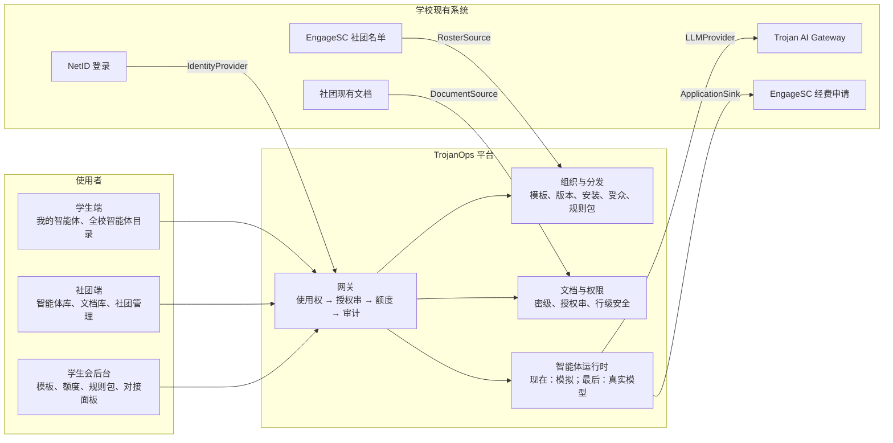

# TrojanOps

TrojanOps 把 USC 现有的身份、社团名单、文档和模型系统接到一个平台上，让每个社团都用上受管的 AI 智能体：

- 社团对外发布公开智能体，服务全校学生；
- 社团对内使用内部智能体，服务成员和干部；
- 学生会统一分发智能体模板、分配额度、制定规则。

每次智能体运行都经过平台网关。一次运行能读哪些文档，由 PostgreSQL 行级安全策略决定。

这是 AI@USC Hackathon（2026 年 11 月 14–15 日）的参赛项目。平台先在模拟运行时上完整跑通，真实智能体（模型、检索、工具）最后接入。本项目是学生黑客松作品，与 USC 和 USC 学生会没有官方关联。

## 架构总览



| 层 | 职责 |
|---|---|
| 学校系统接入 | 每个对接点是一个接口：`IdentityProvider`、`RosterSource`、`DocumentSource`、`LLMProvider`、`ApplicationSink`。比赛中都接模拟实现，换成真实系统时平台其余部分不用改。学生会后台的对接面板列出每个接口当前的实现和最近一次同步。 |
| 网关 | 每次智能体运行和工具调用的唯一入口。它是服务端模块，不是 Next.js 的 `middleware`，因为要在数据库事务里设置授权串，并按实际用量结算。 |
| 组织与分发 | 学生会和社团都是组织。模板带版本，安装属于社团。受众（谁能用）和可读上限（最多读哪一级文档）分开声明。规则包带版本，发布后下一次运行就生效。 |
| 文档与权限 | 文档属于社团，按密级打标，由触发器写入授权串。数据库按授权串和行级安全策略决定一次运行能读哪些文档。 |
| 智能体运行时 | 现在只定接口 `AgentRuntime`。模拟实现不调用模型，只列出这次运行能读的文档；最后通过 `LLMProvider` 接入选定的模型。 |

### 智能体分发

| 方向 | 发布方 | 使用者 | 例子 |
|---|---|---|---|
| 学生会 → 社团 | 学生会 | 每个社团的指定职位或全体成员 | 经费预检、活动筹办 |
| 社团 → 本社团 | 社团 | 本社团成员或指定干部 | 换届交接、会议纪要 |
| 社团 → 全校学生 | 社团 | 所有登录学生，包括非成员 | 招新问答、演出问答 |

学生从两个入口找到能用的智能体：

- **我的智能体**：按社团列出各社团向自己开放的智能体，并标出开放原因；
- **全校智能体目录**：列出所有社团的公开智能体，不需要先加入社团。

公开智能体的用量记在发布它的社团账上，每个学生每天另有上限。

### 一次运行经过网关的步骤

1. 解析智能体的生效配置；模板已下架或安装已停用时拒绝。
2. 检查使用者在智能体的受众内。
3. 按智能体所属的社团重算使用者的授权串，再按可读上限截断。
4. 预留额度：检查平台、记账社团、安装、成员四层上限，公开智能体另查学生每日上限。任何一层超限都直接拦截，不调用运行时。
5. 在数据库事务里设置授权串，由行级安全策略列出可读文档。
6. 调用智能体运行时。
7. 写入类工具只生成待确认的动作，由有权限的人确认后执行。
8. 按实际用量结算，写运行记录和审计。

### 权限模型

授权串把“哪个社团的什么人”写成字符串：

- `*`：所有登录学生；
- `<社团>:*`：本社团全体成员；
- `<社团>:<职位>`：本社团的指定职位。

文档的授权串由它的密级决定，干部级文档始终包含主席。使用者的授权串在每次运行时按智能体所属的社团重算，再按可读上限截断：上限为公开时只保留 `*`，上限为成员时保留到 `<社团>:*`。

一份文档可读，需要同时满足两个条件：

- 文档的授权串和截断后的授权串有交集；
- 文档在智能体的知识源内。

公开智能体的可读上限固定为公开，社团对外开放智能体时，内部资料因此不会流出去。

### 技术栈

- Next.js（App Router）、TypeScript、pnpm
- Tailwind CSS、shadcn/ui
- PostgreSQL 17（`pgvector/pgvector:pg17` 镜像）、Drizzle ORM
- Zod、Vitest

## 演示流程

演示分八步，每一步都运行真实的平台逻辑，智能体通过模拟运行时回答：

1. 对接面板与名单同步
2. 学生会分发模板
3. 社团发布公开智能体
4. 内部与公开的权限差别
5. 额度拦截
6. 规则包更新
7. 换届移交
8. 审计

每一步的验收标准见 `docs/architecture.md` §1。

## 仓库结构

| 路径 | 内容 |
|---|---|
| `AGENTS.md` | 所有智能体共用的规则：每条工作流能改哪些路径、第 2 小时冻结的接口、不变量、每个桩代码的合入时间和完成时间 |
| `CLAUDE.md` | 引用 `AGENTS.md`，列出可用的子智能体，要求每个任务先出方案再改代码 |
| `docs/architecture.md` | 完整规格：演示步骤、数据模型、接口、网关、页面和工作包 |
| `docs/streams/` | 每条工作流一份任务说明：工作包和时间、要交出的接口、要用别人的接口、第一条提示词 |
| `docs/workflow.md` | 分支、PR、接口变更流程、完成标准 |
| `docs/decisions.md` | 已经定下的决定 |
| `.claude/agents/` | 每条工作流一个子智能体，另有 `ui-designer` 和 `reviewer` |
| `.github/pull_request_template.md` | PR 模板 |

代码目录的布局和每个路径的归属见 `docs/architecture.md` §4。团队版架构文档和页面清单在 Claude 文档里，链接在团队群。

## 分工

| 工作流 | 负责人 | 工作包 | 交付 |
|---|---|---|---|
| A 平台核心 | 待定 | WP-0（牵头）、WP-1、WP-3、WP-4、WP-13 | 项目骨架、表与行级安全、身份与授权串、网关；最后接入模型 |
| B 分发 | 待定 | WP-5、WP-7、WP-6 | 分发引擎、社团端页面与换届移交、学生会控制台 |
| C 文档与权限 | 待定 | WP-8、WP-9、WP-14 | 文档库、运行页与检查面板、权限预览、审计视图；最后做检索与工具 |
| D 对接与演示 | 待定 | WP-2、WP-10、WP-11、WP-12 | 种子数据与界面骨架、对接层与对接面板、学生端、演示与路演 |

| 时间 | 检查点 |
|---|---|
| H2 | 冻结接口和表结构 |
| H3 | 每条工作流把别人要用的接口以桩代码合入 `main` |
| H8 | 每个页面都能显示种子数据，`main` 上 `pnpm check` 通过 |
| H12 | 冻结平台功能，八个演示步骤在模拟运行时上全部跑通 |
| H14 | 接入最小的真实智能体；做不到就整场用模拟运行时 |
| H18 | 完成三次彩排 |

## 本地环境

需要 Node.js 22 以上、pnpm 12 和 Docker Desktop。

```bash
npm i -g pnpm@12.18.0     # 没有 pnpm 时
pnpm install
cp .env.example .env
pnpm db:up                # 启动 PostgreSQL 17
pnpm db:reset             # 建表、行级安全、种子数据；可以反复运行
pnpm dev                  # http://localhost:3000
pnpm check                # 类型检查、lint、测试、不变量和设计检查
```

Windows 上不需要 bash：`pnpm check` 是 Node 脚本（需要 Node 20.12 或更高）；数据库用 Docker Desktop 启动。

应用以 `trojanops_app` 角色连接数据库，行级安全对它生效。`DATABASE_OWNER_URL` 只给 `pnpm db:reset` 用。

`DEMO_MODE=1` 时，`/` 是演示登录页。登录 ID 填种子账号的演示邮箱（如 `sam@demo.trojanops.test`）或 NetID（`sam`），密码统一是 `fighton`。登录后按角色进入不同页面：USG 管理员进 `/usg/integrations`，社长进社团首页，其他成员进 `/me/agents`，没有社团的学生进 `/directory`。

演示时用 `/?account=N` 直接预填第 N 个账号，点 Sign in 即可：1 avery（USG 管理员）、2 sam（Startup 社长）、3 taylor（Startup 财务）、4 jordan、5 casey（Startup 成员）、6 lee（无社团）、7 morgan（Archery 财务 + Startup 成员）、8 riley（USG 审核员）。已登录时也可以用这个链接直接换人。

## 开始工作

1. 认领一条工作流，读 `docs/streams/<工作流>.md`。
2. 把文件末尾的第一条提示词交给 Claude Code，确认它给出的方案后再改代码。
3. 每个工作包开一个分支，命名为 `<工作流>/<工作包>-<主题>`，例如 `b/wp5-distribute`。
4. 只改自己工作流的路径。别人的模块还没做完时，直接导入它在真实路径上的桩代码，不自己写替代品。
5. 开 PR 前运行 `reviewer` 子智能体和 `pnpm check`，变基到 `main` 后压缩合并。

分支、PR 和接口变更的完整规则见 `docs/workflow.md`。
